# Arista Southwest Region Newsletter

Welcome to the November 2026 Newsletter for Arista customers in the U.S. Southwest Region! 

We welcome your feedback on the newsletter. If you have any ideas or suggestions on how to improve the newsletter, please reach out to [southwest@arista.com](mailto:southwest@arista.com){: target="_blank" }.  

---

## Leadership Perspectives — Recent Blogs from Arista Leadership

-   **Real-Time AI Inferencing Demands a Distributed Front-End Network**
    ---
    *Nov 17th, 2026: Tyson Lamoreaux and Brendan Gibbs explain how
    distributed front-end networks using Arista EOS and the R4
    portfolio bring AI inference closer to users to cut latency and
    bypass power limits.*
    
    [Read Blog](https://blogs.arista.com/blog/real-time-ai-inferencing){: target="_blank" }

-   **Next-Gen Scale-Up Networking for AI Fabrics**
    ---
    *Oct 7th, 2026: Arihant Jain and Vijay Vusirikala detail Arista's open, Ethernet-based "Scale-Up" architecture that leverages the ESUN initiative and advanced liquid-cooled rack designs to link hundreds of AI accelerators into a single supercomputing instance without vendor lock-in.*
    
    [Read Blog](https://blogs.arista.com/blog/next-gen-scale-up-networking-for-ai-fabrics){: target="_blank" }

[Explore All Blogs](https://blogs.arista.com/blog){: target="_blank" }

---

## Southwest Region Tech Tip of the Month

!!! info "Troubleshooting Tech Tip: Live CLI Monitoring with EOS Watch"
    

    
    Have you ever found yourself mashing the Up-Arrow and Enter over and over
    again just to see if interface errors are climbing or if a BGP
    neighbor finally came up?

    Enter the **EOS `watch` command**—a built-in way to turn any `show`
    command into a live, auto-refreshing dashboard right in your
    terminal.

    **Why it matters:** Instead of flooding your scrollback buffer with
    dozens of identical outputs and squinting to spot what changed,
    `watch` refreshes the screen in place at an interval you choose.
    Adding the `diff` keyword highlights the exact values that changed
    since the last refresh, making incrementing counters, flapping
    links, or converging routes jump right off the screen.

    **Pro Tip:** Next time you are troubleshooting a live link or
    watching a routing table converge, prefix your command with
    `watch diff`. For example, run
    `watch 2 diff show interfaces Ethernet1 counters errors` to refresh
    every two seconds and highlight any new errors in real time. When
    you are finished, press `Ctrl+C` to drop cleanly back to the
    prompt!
    

---
## Featured Article

### CloudVision Network Provisioning to Studios Migration Tool Workflow
By: Morten Sefeld, Systems Engineer
 

CloudVision Network Provisioning has been expanded upon and advanced in our latest provisioning model, Studios Provisioning. You can easily and quickly migrate all of your configuration and software, as well as their device assignments, from the legacy Network Provisioning feature set to the Studios Provisioning feature set. 

In this article we will show you how we can migrate 6 devices including container and device assigned configlets and assigned EOS software, from Network Provisioning to Studios using the new Studios Migration Tool. 

 
**Migration tool**

The tool is available to activate in CloudVision under Settings -> Feature. Search for “Studios - Network Provisioning Migration, and enable it for your organization.

 

<figure markdown="span">
  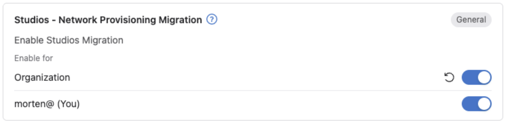
  <figcaption>Migration Tool Feature Toggle</figcaption>
</figure> 

 

Once enabled you will the following a blue migration bar with a Start Migration button in both Network Provisioning and Studios

 

<figure markdown="span">
  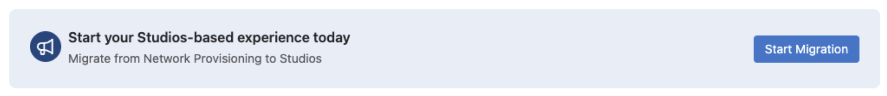
  <figcaption>CloudVision Studios Migration Prompt</figcaption>
</figure> 

Before we start the actual migration, let us discover how the devices, containers and EOS images currently look in the Network Provisioning section.

 
**Containers**

All 6 devices are organized under the Lab Devices container.

 

<figure markdown="span">
  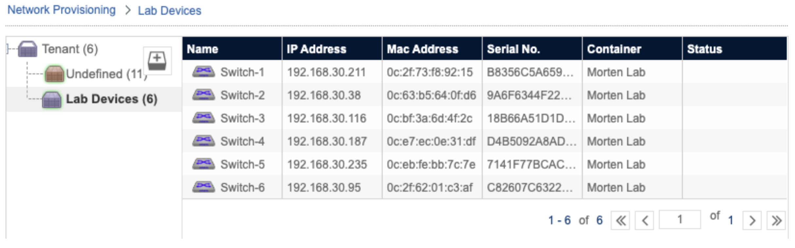
  <figcaption>Network Provisioning Managed Lab Device</figcaption>
</figure> 

 
**Configlets**

Each device has a device specific configlet assigned that is unique to itself, and resides in the Lab Devices container. The Lab Devices container is assigned 2 configlets, which are inherited by all 6 devices in the container. 

 

<figure markdown="span">
  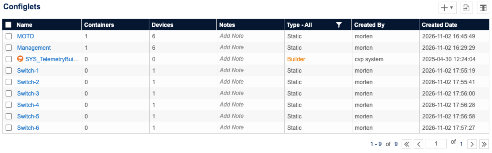
  <figcaption>Network Provisioning Configlets</figcaption>
</figure> 

 
**EOS Images**

All 6 devices are vEOS lab devices and assigned vEOS-lab-4.32.3M via the Lab Devices Container. 

 

<figure markdown="span">
  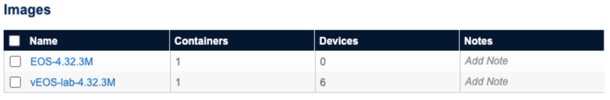
  <figcaption>Network Provisioning Image Repository</figcaption>
</figure> 

 
**Migration Steps**

To begin the migration itself, click the blue Start Migration button and walk through the guide where you first will be presented some highlights of Studios such as Real-Time Collaboration, Automated Validation, Granular Access Control among other features.

 

<figure markdown="span">
  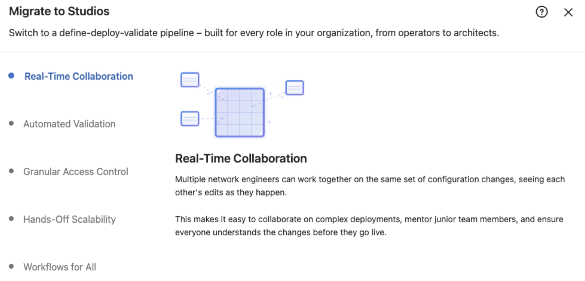
  <figcaption>Migration to Studios - Steps Start</figcaption>
</figure> 

Click Next to proceed to the migration screen where the five migration steps are listed. 

**Step-1.**  The migration tool automatically performs checks to ensure compatibility and a flawless migration. On successful checks the actual migration begins.

 

<figure markdown="span">
  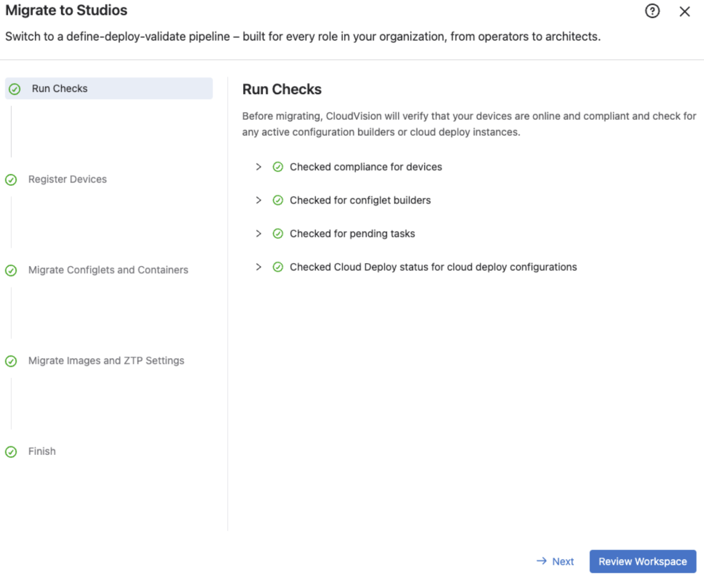
  <figcaption>Migration to Studios - Steps Complete</figcaption>
</figure> 

**Step-2.** Your devices are registered in the Inventory and Topology Studio. 

**Step-3.** Configlets and containers are migrated into the Static Configuration Studio.

 

<figure markdown="span">
  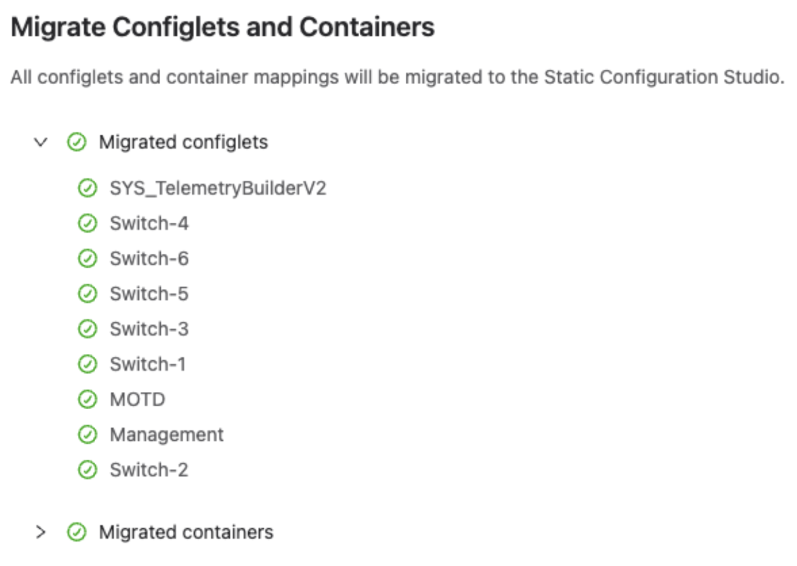
  <figcaption>Migration Configlet and Container Mappings</figcaption>
</figure> 

**Step-4.** In this final migration step all EOS images and ZTP setting are copied into the Software Management Studio 

**Step-5.** Finish the migration. If all previous steps were successful you can review the automatically created migration workspace and submit it to complete the migration. 

 

<figure markdown="span">
  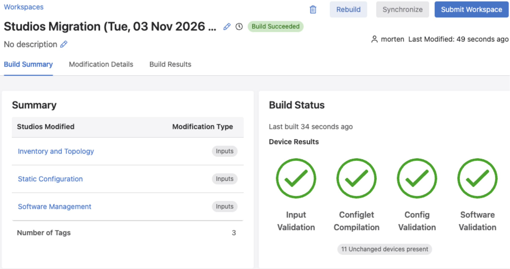
  <figcaption>Migration Workspace Review in Studios</figcaption>
</figure> 

Please notice that no configuration or software updates are pushed onto the devices, as this is an internal CloudVision migration, and no devices running configuration will be touched during the process. 

 

<figure markdown="span">
  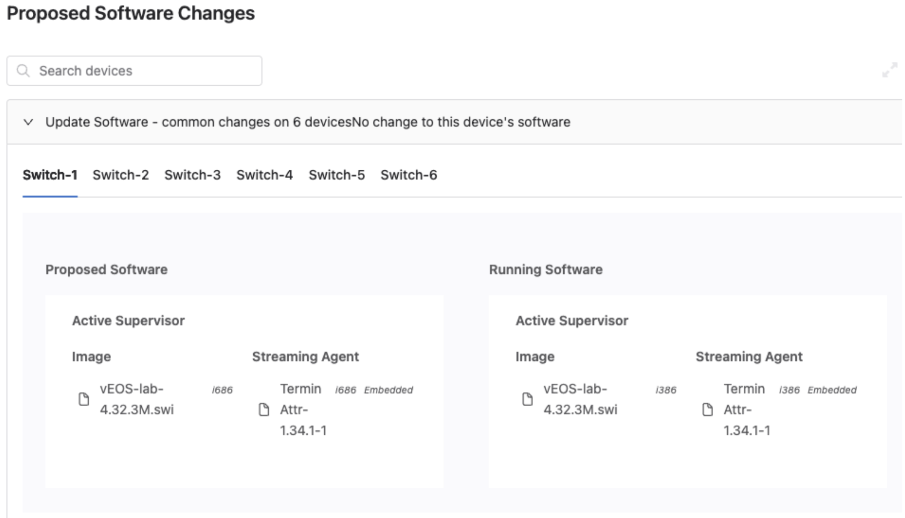
  <figcaption>Migration Proposed Software Changes</figcaption>
</figure> 

 

<figure markdown="span">
  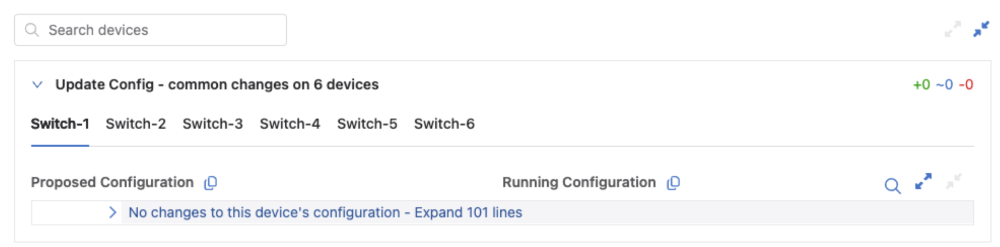
  <figcaption>Migration Proposed Configuration Changes</figcaption>
</figure> 

**Important.** Be aware that migration is a one time process and can not be re-run after successful completion. CloudVision is fully migrated to Studios and the Network Provisioning feature will be disabled and removed from the provisioning menu in CloudVision.

 
**Post Migration Checks**

All 6 devices from Network Provisioning were successfully migrated and are active in the inventory and Topology Studio.

 

<figure markdown="span">
  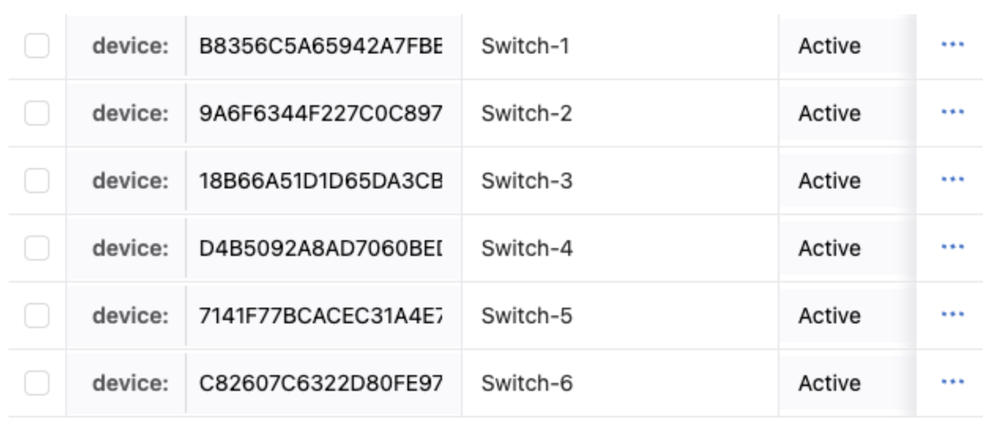
  <figcaption>Migration Device Validation</figcaption>
</figure> 

Containers and configlet assignments can be found in the Static Configuration Studio. Notice the Tenant and Lab Devices containers, and that Lab Devices have two configlets assigned, and each of the 6 devices have one configlet directly assigned. 

 

<figure markdown="span">
  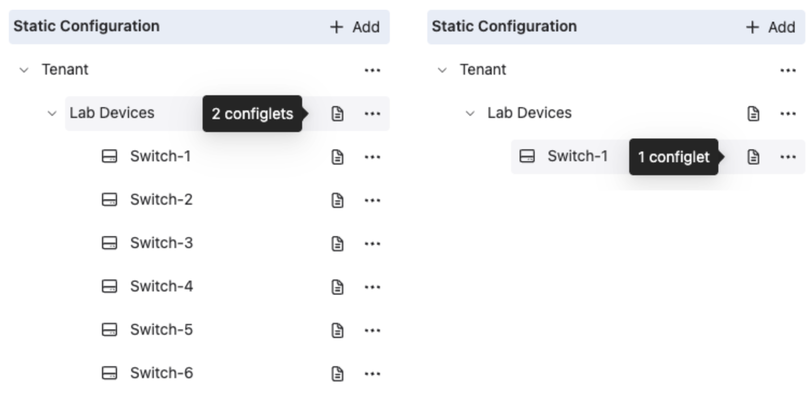
  <figcaption>Static Configuration Studio Container Tree</figcaption>
</figure> 

In Software Management Studio the vEOS-lab-4.32M EOS bundle is assigned the 6 devices exactly as previously in the image Repository.

 

<figure markdown="span">
  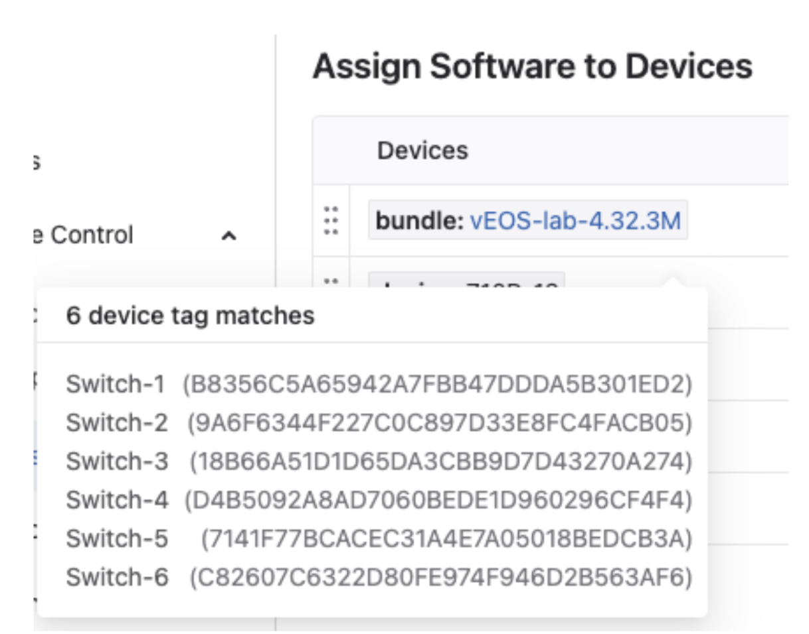
  <figcaption>Software Management Studio - Image to Device List Mapping Using Tags</figcaption>
</figure> 

This concludes the Network Provisioning to Studios migration. We have successfully migrated all configlets and images from the legacy Network Provisioning model into the enhanced Studios Workflow, distributing everything into the relevant studios.

---
 

## __*Upcoming Events*__  
Arista hosts various events throughout the year for you! Members of our team organize these informative events to showcase Arista's ability to not only help improve your network, but to also assist by providing a set of tools to improve your operations!  

Click on the boxes below to be directed to Arista's website for additional lists of Webinars and Events.

-   __Webinars__  

    --- 

    We make it easy for you to view products that are of interest, all virtually! Technical members of the team showcase outstanding explanations of the products. Click below to see our list of Webinars. 

    [Arista Webinars](https://www.arista.com/en/company/news/webinars){.md-button target="_blank"}

-   __Events__ 

    ---
    Join us in person to get a closer look at our list of products and solutions, as well as get the chance to meet members of the team. Click below to see our list of upcoming Events. 

    [Upcoming Events](https://www.arista.com/en/company/news/events){ .md-button target="_blank" }

--- 

## __*Software Updates*__

*Stay informed on the latest software updates across all Arista products and services.*

|  Software    | Version      |  Release Date |
| :-----------: | :-----------: | :-----------: |
| __EOS__           | 4.34.9M   4.33.11M   4.35.7M | October 15th, 2026   October 15th, 2026   October 14th, 2026 |
| __CVP__           | Portal 2026.3.0.1   Appliance 7.2.0   Sensor 1.4.3 | October 27th, 2026   July 2nd, 2026   September 3rd, 2026 |
| __DMF__           | 8.9.1 | October 20th, 2026 |
| __CV-CUE__         | 2026.3.0 | October 12th, 2026 |
| __Arista NDR__     | 5.3.5 | July 16th, 2025 |
| __TerminAttr__     | 1.46.2 | October 12th, 2026 |
| __VeloCloud SD-WAN__  Orchestrator/Gateway/Edge | 7.0.0 | July, 2026 |

[View All Latest Software Updates](https://www.arista.com/en/support/software-download){: .md-button .md-button--primary target="_blank" }

---

## __* Security Advisories and Field Notices*__

*Stay informed on the latest platform security and field notice updates. For more information on Arista's statement on AI-Enhanced Security and Resilience regarding Mythos and project Glasswing, [click here.](https://www.arista.com/assets/data/pdf/glasswing/QA-Project-Mythos-Glasswing.pdf){: target="_blank" }*

### **Security Advisories**
* To View the **Latest Arista PSIRT Advisories**, click the following link — [Arista PSIRT Advisories](https://www.arista.com/en/support/advisories-notices){: target="_blank" }   

 

* **Are you a CloudVision Customer?** Leverage the following workflow to remediate PSIRTs affecting your EOS devices   
       - Configure **Event Notifications** to be alerted as new PSIRTs are released — [CloudVision Event Notifications](https://www.arista.io/help/articles/events-configure-notifications){: target="_blank" }  
       - View the **Compliance Dashboard** to see a list of impacted devices, an overview of each CVE, and remediation next steps — [CloudVision Compliance Dashboard](https://www.arista.io/help/articles/devices-compliance-bug-cve){: target="_blank" }  
       - Upgrade EOS devices using the **Software Management Studio** to resolve threats from impacted devices — [CloudVision Software Management Studio](https://www.arista.io/help/articles/provisioning-studios-built-in-software){: target="_blank" }      

 

* **Not a CloudVision Customer?** Leverage the Arista ANTA PSIRT CLI workflow to generate a report that illustrates which CVEs are impacting your devices — [ANTA PSIRT CLI Feature](https://anta.arista.com/stable/security-advisory/usage/){: target="_blank" }   
       - Visit **Labs.Arista.com** to try out the ANTA PSIRT CLI Feature Today — [ANTA PSIRT Assessment Lab](https://labs.arista.com/labs#tech-lib-tab-no-module){: target="_blank" }  
 

### **Field Notices**
- **CloudVision On-Prem Kubernetes API Server** — [Field Notice 0148](https://www.arista.com/en/support/advisories-notices/field-notice/25223-field-notice-0148){: target="_blank" }   *(November 23rd, 2026)*
- **eMudhra Intermediate CA key compromise** — [Field Notice 0147](https://www.arista.com/en/support/advisories-notices/field-notice/25222-field-notice-0147){: target="_blank" }   *(November 23rd, 2026)*
- **VeloCloud Edge devices Man in the Middle attacks exposure** — [Field Notice 0146](https://www.arista.com/en/support/advisories-notices/field-notice/25175-field-notice-0146){: target="_blank" }   *(November 17th, 2026)*
- **Arista Infrastructure services transitioning to Dual Stack IPv4 IPv6 for AP to Cloud Connectivity** — [Field Notice 0145](https://www.arista.com/en/support/advisories-notices/field-notice/25059-field-notice-0145){: target="_blank" }   *(November 10th, 2026)*
- **Canada Permanent Daylight Savings Time** — [Field Notice 0144](https://www.arista.com/en/support/advisories-notices/field-notice/25022-field-notice-0144){: target="_blank" }   *(November 3rd, 2026)*
 

[View All of the Latest Advisories & Notices](https://www.arista.com/en/support/advisories-notices){: .md-button .md-button--primary target="_blank" }

---

## __* Product Updates*__

*Stay up to date on all new Arista Product Releases, as well as End of Sale/End of Support Notices.*

### **New Product Releases** 
* **Q4 2026** — [Rack-Scale Architectures for Scale-Up and Scale-Out AI Fabrics ](https://www.arista.com/en/company/news/press-release/24818-pr-20261007 ){: target="_blank" }

###  **End of Sale / End of Software Support**
- **October 27th, 2026** — [DCA-DM-AN660](https://www.arista.com/en/support/advisories-notices/endofsale){: target="_blank" }
- **October 23rd, 2026** — [EOS-4.31 Train](https://www.arista.com/en/support/advisories-notices/endofsale){: target="_blank" }
- **October 6th, 2026** — [2025.1 Train](https://www.arista.com/en/support/advisories-notices/endofsale){: target="_blank" }

 

[View All Latest End of Sale & Support Notices](https://www.arista.com/en/support/advisories-notices/endofsale){: .md-button .md-button--primary target="_blank" }

---

## Did You Know? 
Arista has revamped their certifications! The new **Arista Certified Engineer (ACE)** program is now organized by specific tracks like Cloud Data Center, Campus, and Automation to better align with your job role.

[Start your ACE journey now](https://www.training.arista.com/){ .md-button .md-button--primary target="_blank" }

---

---
## *Your Southwest Regional Team is Here to Support Your Success.* 

---

  <h3 style="color: #004a99; margin-top: 0;">Let's Connect</h3>
  
Thanks for reading! Your local Arista team is here to help you navigate your evolving network needs. Reach out anytime to southwest@arista.com for more information or technical guidance. Until next month—stay connected!

  <a href="mailto:southwest@arista.com" class="md-button md-button--primary">Contact Your Local Team</a>

