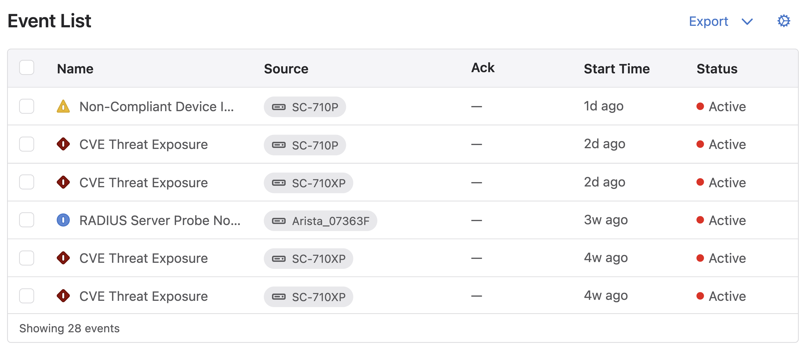
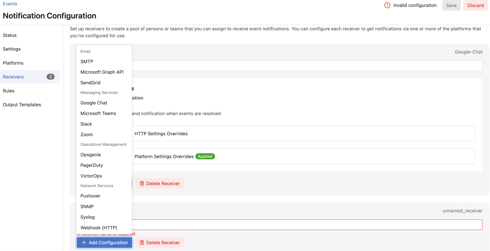
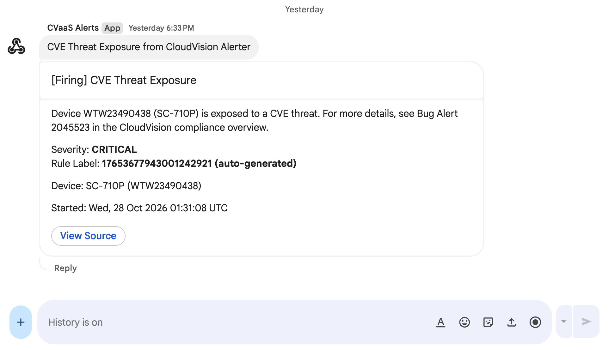
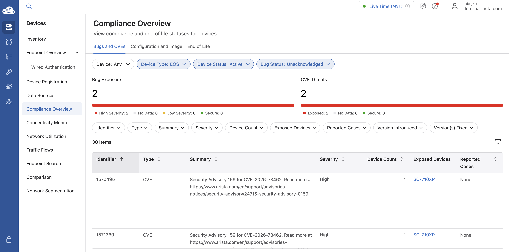
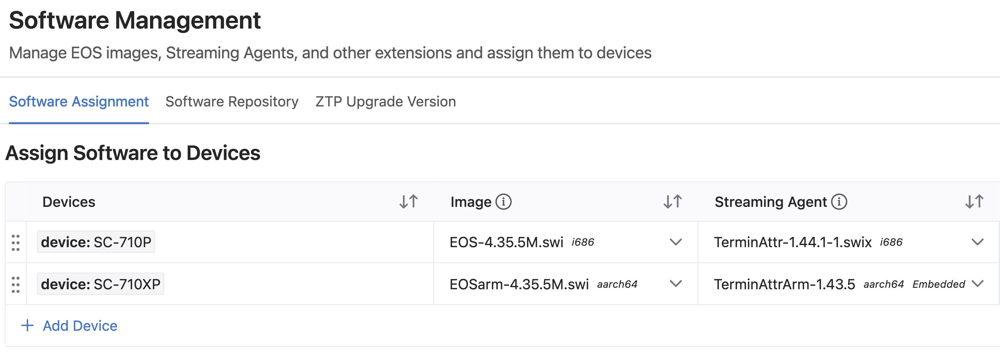
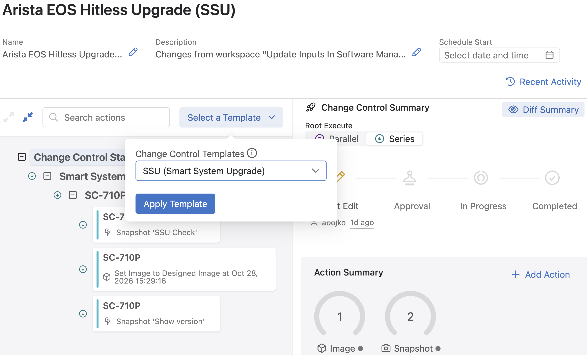
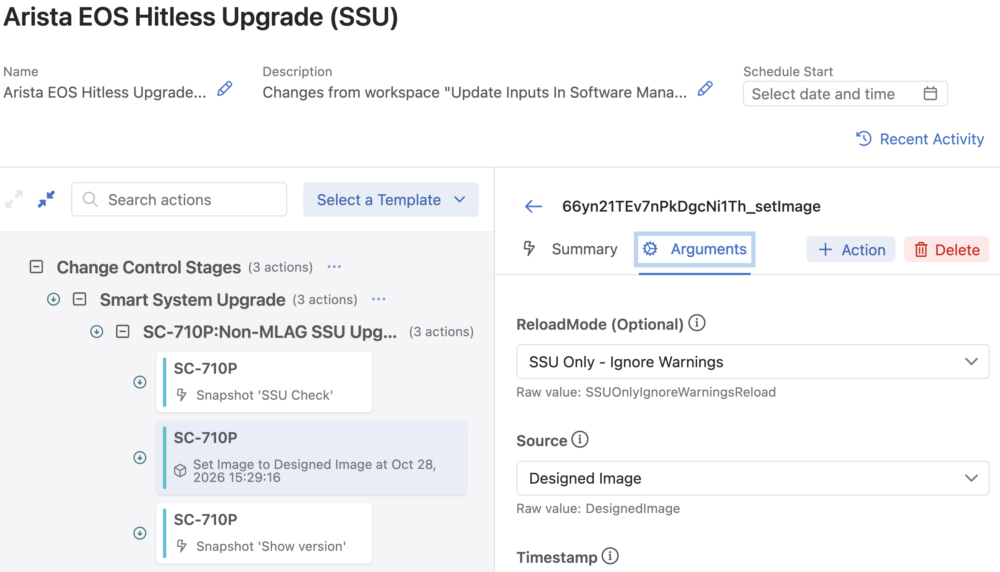

# Arista Southwest Region Newsletter

Welcome to the October 2026 Newsletter for Arista customers in the U.S. Southwest Region! 

We welcome your feedback on the newsletter. If you have any ideas or suggestions on how to improve the newsletter, please reach out to [southwest@arista.com](mailto:southwest@arista.com){: target="_blank" }.  

---

## Leadership Perspectives — Recent Blogs from Arista Leadership

-   **Next-Gen Scale-Up Networking for AI Fabrics**
    ---
    *Oct 7th, 2026: Arihant Jain and Vijay Vusirikala detail Arista's open, Ethernet-based "Scale-Up" architecture that leverages the ESUN initiative and advanced liquid-cooled rack designs to link hundreds of AI accelerators into a single supercomputing instance without vendor lock-in.*
    
    [Read Blog](https://blogs.arista.com/blog/next-gen-scale-up-networking-for-ai-fabrics){: target="_blank" }

-   **The Next Frontier for AI Fabrics: Scale Across Networking**
    ---
    *Sep 22nd, 2026: Jayshree Ullal and Brendan Gibbs introduce Arista's Scale-Across strategy and REACH framework, demonstrating how the 7800 AI Spine and SRv6 unite geographically distributed data centers to bypass local power and space constraints for massive AI workloads.*
    
    [Read Blog](https://blogs.arista.com/blog/the-next-frontier-for-ai-fabrics-scale-across-networking){: target="_blank" }

[Explore All Blogs](https://blogs.arista.com/blog){: target="_blank" }

---

## Southwest Region Tech Tip of the Quarter

!!! info "Time Travel is Real: Troubleshooting with CloudVision's Topology Replay"
    

    Ever tried to troubleshoot a transient network issue that happened at 3:00 AM, long after the alerts have cleared and the logs have rolled over? 
    
    Enter **CloudVision's Topology Replay**—essentially a DVR for your entire network state.
    
    **Why it matters:** Because Arista EOS streams *every* state change to CloudVision's Network Data Lake (NetDL), you aren't limited to relying on syslog messages or real-time polling. You can seamlessly scrub backward in time to see the exact state of your topology, routing tables, MAC addresses, and interface counters at the precise millisecond an issue occurred. No more guessing what the network looked like during a blip.
    
    **Pro Tip:** The next time you are investigating a past event, navigate to the **Topology** view in CloudVision. Look for the **Time / Clock icon** at the bottom of the screen. Click it, switch from *Live* to *Historical*, and punch in the exact date and time of the incident. Watch your entire topology map, link health colors, and device states instantly revert to exactly how they looked at that very moment!
    

---
## Featured Articles

###  Integrated Packet Capture for Modern Arista Networks
By: Alex Bojko, Advisory Systems Engineer
 

As network infrastructures scale and cyber threats evolve at ever increasing speeds, maintaining a hardened security posture is no longer a feasible manual exercise. 

When a new Common Vulnerabilities and Exposures (CVE) or PSIRT (Product Security Incident Response Team) advisory is announced, network operations teams are immediately on the clock to identify impacted devices, assess the risk, and deploy remediation changes.

Due to project Glasswing and Mythos, and other advancements in AI driven vulnerability discovery, the amount of new CVEs impacting network infrastructure has risen dramatically. This is putting an enhanced focus and additional stress on network operations teams to maintain network security compliance. In short, we need a method that will assist us in identifying which CVEs are impacting our devices and a seamless approach to remediating them.

 
Arista provides not one, but two powerful, automated workflows to streamline this exact process.

- the turnkey UI-driven approach of CloudVision
- and the programmatic, CLI-driven approach using the ANTA PSIRT (Arista Network Test Automation) Feature

In this article, we will discuss and outline the first approach, starting with CloudVision as a Service (CVaaS). Stay tuned next month for Part 2, which will include a detailed write up on the ANTA PSIRT approach.

 

**Part 1: Discovering and Remediating CVEs using CloudVision**

Let's start with an example scenario. It's a random Tuesday afternoon and you've just left your fourth meeting for the day. Your boss is growing concerned with the advancements of AI and how that will impact network security, and messages you asking you to detail exactly how you plan to keep the network hardened. Luckily for you, CloudVision is at your disposal. 

After doing some research, you learn that Arista (among all other vendors) is seeing an increase in CVEs impacting network devices due to advancements in AI based vulnerability detection methods. The first question we must answer is as follows:

 
> *"How do I know when one of my EOS devices becomes impacted by a new CVE?"*

 

Since we have access to CloudVision, and have successfully onboarded all of our EOS devices, we can leverage the powerful "Event Notification" feature to answer this question. 

Events are generated when criteria for a specific issue is met, and are visible in a dedicated "Events" tab within CloudVision. 

 

<figure markdown="span">
  
  <figcaption>CloudVision Events Page</figcaption>
</figure> 

 
We have the ability to configure alerting to 3rd party receivers when a new event impacts one or all of our devices (see screenshot below for list of 3rd party integrations). For this case, we will need to configure event notifications for "CVE Exposure" 

 

<figure markdown="span">
  
  <figcaption>CloudVision Event Notification 3rd Party Integrations</figcaption>
</figure> 

 

Detailed steps for configuring event notifications in CloudVision can be found at the following link: [CloudVision Event Notifications](https://www.arista.io/help/articles/events-configure-notifications){: target="_blank" }.

Once configured, anytime a new CVE is found to be impacting one of our Arista switches, we will receive an alert within the 3rd party source that we provisioned for alerts. Below is an example from Google Chat:

 

<figure markdown="span">
  
  <figcaption>CloudVision Event Notification Alert - Google Chat</figcaption>
</figure> 

 

Knowing exactly when a new CVE is detected on a device is very powerful, but that leads us to the next question:

 
> *"Where can I go to see a list of all the CVEs currently impacting all of my EOS devices?"*

 

Under the Device tab, CloudVision has a built in "Compliance Dashboard" that details CVE's, Bugs, Configuration and Image Compliance, and End of Sale and Software Support information. 

It is here, within the CVE and Bug section, where we can find a list detailing:
- CVE ID
- Severity Level
- Description
- Number of Impacted EOS devices
- Hostname of each impacted device
- EOS Version introduced
- EOS Version Fixed

 

<figure markdown="span">
  
  <figcaption>CloudVision Compliance Overview Dashboard</figcaption>
</figure> 

 

The Compliance Overview Dashboard provides you with a one stop shop to see everything you need to know about CVEs that are impacting EOS devices on your network. It even lists the version of EOS in which the CVE was fixed!

For more information on the compliance dashboard, see the following link: [CloudVision Compliance Dashboard](https://www.arista.io/help/articles/devices-compliance-bug-cve){: target="_blank" }. 

Armed with this information, we can move on and ask this question:

 
> *"I know which version of EOS I need to upgrade to in order to remediate CVEs from my device. Can I use CloudVision to facilitate EOS upgrades? And how long should I expect my switch to remain offline during the software reboot? I need to notify other teams and customers of this upcoming outage window."*

 

Here's where things get very interesting. Not only can CloudVision be used to orchestrate EOS software upgrades, we can orchestrate them in such a way so that they are hitless (completely invisible to end hosts with no impact to the network). 

Once we have identified the target version of EOS to upgrade to in order to remediate the CVE impact, we can then leverage the Software Management Studio within the Provisioning tab of CloudVision to download the EOS image and assign it to a single device or group of devices. 

For more information on the software management studio, see the following link: [CloudVision Software Management Studio](https://www.arista.io/help/articles/provisioning-studios-built-in-software){: target="_blank" }.

 

<figure markdown="span">
  
  <figcaption>CloudVision Studios - Software Management Studio</figcaption>
</figure> 

 

Once assigned, we submit the workspace in Studios and navigate to the prompted Change Control tab. Before executing, we must specify this upgrade as a SSU (Smart System Upgrade) in order to upgrade in a hitless fashion. We can do this using one of two methods, using a preconfigured change control template or via the Device Arguments section.

Leveraging a hitless upgrade using a preconfigured Change Control Template is shown below. The template is the ideal approach, providing you with pre-set stages where Snapshots, or outputs of various show commands, can be integrated into the change control, as well as automatically designating the device for a hitless SSU upgrade. 

For more information on Change Control Templates, see the following link: [Change Control Templates](https://www.arista.io/help/articles/provisioning-change-control-templates){: target="_blank" }.

 

<figure markdown="span">
  
  <figcaption>CloudVision Change Control Template</figcaption>
</figure> 

 

Leveraging a hitless upgrade using the Device Arguments tab is shown below. This is the required approach if not leveraging a pre configured template.

 

<figure markdown="span">
  
  <figcaption>CloudVision Change Control - SSU Argument Option</figcaption>
</figure> 

 

At this point, you may be asking yourself another question:

 
> *"Is this upgrade truly hitless, won't I impact end users once I execute this Change Control and upgrade the software on my switch?"*

 

The answer to that question is as follows: This is a truly hitless upgrade, and there will not be any noticeable impact to end users. With SSU, the device still reloads, however it uses the last known state of the control plane to continue forwarding traffic in the data plane during the reload while the control plane is offline, all while still supplying PoE to end devices and full connectivity to users. 

For more information on EOS Hitless Upgrades, see the following link: [EOS Hitless Upgrades](https://tech-library.arista.com/solution_guides/ssu/){: target="_blank" }. 

Once the SSU hitless upgrade method is specified on the desired device(s) within the Change control, we can execute the change control and upgrade the device. 

That brings us to the final question:

 
> *"How do I verify the CVEs are no longer impacting my device(s)?"*

 

The answer to this question is the same approach to how we identify which CVEs are currently impacting our EOS devices. The Compliance Overview Dashboard in CloudVision will automatically update both once new CVEs are found, and once CVEs are remediated, all thanks to the real time streaming telemetry capabilities of Arista EOS and CloudVision. 

I hope you found this article helpful. Please stay tuned for Part 2 next month, where we will discuss identifying CVEs on EOS devices using the ANTA PSIRT Framework.

---
 

## __*Upcoming Events*__  
Arista hosts various events throughout the year for you! Members of our team organize these informative events to showcase Arista's ability to not only help improve your network, but to also assist by providing a set of tools to improve your operations!  

Click on the boxes below to be directed to Arista's website for additional lists of Webinars and Events.

-   __Webinars__  

    --- 

    We make it easy for you to view products that are of interest, all virtually! Technical members of the team showcase outstanding explanations of the products. Click below to see our list of Webinars. 

    [Arista Webinars](https://www.arista.com/en/company/news/webinars){.md-button target="_blank"}

-   __Events__ 

    ---
    Join us in person to get a closer look at our list of products and solutions, as well as get the chance to meet members of the team. Click below to see our list of upcoming Events. 

    [Upcoming Events](https://www.arista.com/en/company/news/events){ .md-button target="_blank" }

--- 

## __*Software Updates*__

*Stay informed on the latest software updates across all Arista products and services.*

|  Software    | Version      |  Release Date |
| :-----------: | :-----------: | :-----------: |
| __EOS__           | 4.34.9M   4.33.11M   4.35.7M | October 15th, 2026   October 15th, 2026   October 14th, 2026 |
| __CVP__           | Portal 2026.3.0.1   Appliance 7.2.0   Sensor 1.4.3 | October 27th, 2026   July 2nd, 2026   September 3rd, 2026 |
| __DMF__           | 8.9.1 | October 20th, 2026 |
| __CV-CUE__         | 2026.3.0 | October 12th, 2026 |
| __Arista NDR__     | 5.3.5 | July 16th, 2025 |
| __TerminAttr__     | 1.46.2 | October 12th, 2026 |
| __VeloCloud SD-WAN__  Orchestrator/Gateway/Edge | 7.0.0 | July, 2026 |

[View All Latest Software Updates](https://www.arista.com/en/support/software-download){: .md-button .md-button--primary target="_blank" }

---

## __* Security Advisories and Field Notices*__

*Stay informed on the latest platform security and field notice updates. For more information on Arista's statement on AI-Enhanced Security and Resilience regarding Mythos and project Glasswing, [click here.](https://www.arista.com/assets/data/pdf/glasswing/QA-Project-Mythos-Glasswing.pdf){: target="_blank" }*

### **Security Advisories**
* To View the **Latest Arista PSIRT Advisories**, click the following link — [Arista PSIRT Advisories](https://www.arista.com/en/support/advisories-notices){: target="_blank" }   

 

* **Are you a CloudVision Customer?** Leverage the following workflow to remediate PSIRTs affecting your EOS devices   
       - Configure **Event Notifications** to be alerted as new PSIRTs are released — [CloudVision Event Notifications](https://www.arista.io/help/articles/events-configure-notifications){: target="_blank" }  
       - View the **Compliance Dashboard** to see a list of impacted devices, an overview of each CVE, and remediation next steps — [CloudVision Compliance Dashboard](https://www.arista.io/help/articles/devices-compliance-bug-cve){: target="_blank" }  
       - Upgrade EOS devices using the **Software Management Studio** to resolve threats from impacted devices — [CloudVision Software Management Studio](https://www.arista.io/help/articles/provisioning-studios-built-in-software){: target="_blank" }      

 

* **Not a CloudVision Customer?** Leverage the Arista ANTA PSIRT CLI workflow to generate a report that illustrates which CVEs are impacting your devices — [ANTA PSIRT CLI Feature](https://anta.arista.com/stable/security-advisory/usage/){: target="_blank" }   
       - Visit **Labs.Arista.com** to try out the ANTA PSIRT CLI Feature Today — [ANTA PSIRT Assessment Lab](https://labs.arista.com/labs#tech-lib-tab-no-module){: target="_blank" }  
 

### **Field Notices**
- **issue triggering a reboot of the switch after 1042 days of uptime** — [Field Notice 0142](https://www.arista.com/en/support/advisories-notices){: target="_blank" }   *(October 15th, 2026)*
- **CVA Appliance Host Resource Reservation** — [Field Notice 0141](https://www.arista.com/en/support/advisories-notices){: target="_blank" }   *(October 12th, 2026)*
- **CVP On-Prem Data Retention** — [Field Notice 0140](https://www.arista.com/en/support/advisories-notices){: target="_blank" }   *(October 9th, 2026)*
- **Migration of Wi-Fi services from arista.com to arista.io** — [Field Notice 0139](https://www.arista.com/en/support/advisories-notices){: target="_blank" }   *(October 8th, 2026)*
- **Change in defaults of configuration options in CV-CUE after 15th January, 2027** (SSID profiles and Access Point Groups) — [Field Notice 0138](https://www.arista.com/en/support/advisories-notices){: target="_blank" }   *(October 8th, 2026)*
- **New EOS image signing key** (This applies to platforms running EOS 4.30.1F or earlier versions that have Secure Boot enabled) — [Field Notice 0137](https://www.arista.com/en/support/advisories-notices){: target="_blank" }   *(October 7th, 2026)*

 

[View All of the Latest Advisories & Notices](https://www.arista.com/en/support/advisories-notices){: .md-button .md-button--primary target="_blank" }

---

## __* Product Updates*__

*Stay up to date on all new Arista Product Releases, as well as End of Sale/End of Support Notices.*

### **New Product Releases** 
* **Q4 2026** — [Rack-Scale Architectures for Scale-Up and Scale-Out AI Fabrics ](https://www.arista.com/en/company/news/press-release/24818-pr-20261007 ){: target="_blank" }

###  **End of Sale / End of Software Support**
- **October 27th, 2026** — [DCA-DM-AN660](https://www.arista.com/en/support/advisories-notices/endofsale){: target="_blank" }
- **October 23rd, 2026** — [EOS-4.31 Train](https://www.arista.com/en/support/advisories-notices/endofsale){: target="_blank" }
- **October 6th, 2026** — [2025.1 Train](https://www.arista.com/en/support/advisories-notices/endofsale){: target="_blank" }

 

[View All Latest End of Sale & Support Notices](https://www.arista.com/en/support/advisories-notices/endofsale){: .md-button .md-button--primary target="_blank" }

---

## Did You Know? 
Arista has revamped their certifications! The new **Arista Certified Engineer (ACE)** program is now organized by specific tracks like Cloud Data Center, Campus, and Automation to better align with your job role.

[Start your ACE journey now](https://www.training.arista.com/){ .md-button .md-button--primary target="_blank" }

---

---
## *Your Southwest Regional Team is Here to Support Your Success.* 

---

  <h3 style="color: #004a99; margin-top: 0;">Let's Connect</h3>
  
Thanks for reading! Your local Arista team is here to help you navigate your evolving network needs. Reach out anytime to southwest@arista.com for more information or technical guidance. Until next month—stay connected!

  <a href="mailto:southwest@arista.com" class="md-button md-button--primary">Contact Your Local Team</a>

